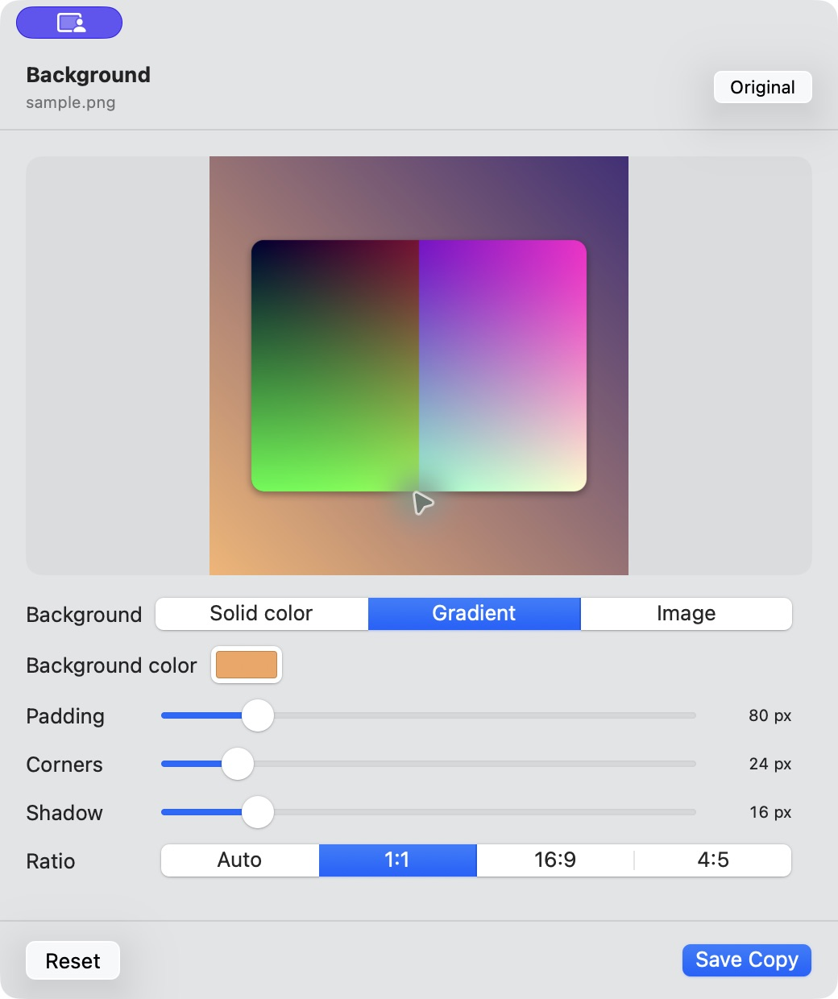

<p align="center">
  
</p>

<h1 align="center">Turnstone</h1>

<p align="center"><strong>Your everyday file tools, a drag away.</strong></p>
<p align="center">Convert, edit, and organize files on your Mac.<br>Free, open source, and offline.</p>

<p align="center">
  <a href="https://github.com/Brian-An/turnstone/releases/download/v0.1.0-preview.1/Turnstone-0.1.0-preview.1-arm64.dmg"></a>
  <a href="LICENSE"></a>
</p>

<p align="center">Apple Silicon (M1 or later) · macOS 13+ · Preview, not notarized</p>
<p align="center"><a href="#how-it-works">How it works</a> · <a href="#install">Install</a> · <a href="#what-can-i-do-with-it">Features</a> · <a href="#build-from-source">Build from source</a></p>

---

## What it does

Turnstone lives in your menu bar and puts useful file actions next to your cursor.
Drag a file in Finder, tap a shortcut, and a wheel appears with options for that file.
Drop onto an option to convert it, open an editor, or perform a file action.

For example: drag a PNG, tap **Shift**, and drop onto **WEBP** to save a web-friendly copy beside the original.

<p align="center">
  
  <br><sub>The conversion wheel shows formats available for your selected file.</sub>
</p>

## How it works

1. **Drag** one or more files in Finder and keep the mouse button held down.
2. **Tap** a shortcut from the table below to open a wheel.
3. **Release the shortcut key**, move onto the option you want, and keep dragging.
4. **Drop** the files to apply the action or open its editor.

| Shortcut | Opens | Try it with |
| --- | --- | --- |
| **⇧ Shift** | Convert | PNG → WEBP, MOV → MP4, PDF → text |
| **⌘ Command** | Tools | Compress an image, trim audio, reorder PDF pages |
| **⌃ Control** | Actions | AirDrop, Copy Path, Move, or Floating Shelf |

Drop in the center or outside the wheel to cancel.
Change shortcuts in **Settings → General → Drag shortcuts**.

**Prefer a file picker?** Click the Turnstone menu bar icon and choose **Choose Files…**, or drop files into its welcome window.
Use the arrow keys to select an option, **Return** to apply it, and **Escape** to close the wheel.

Conversions and edits save **new copies beside your originals**.
If a name is already taken, Turnstone adds a number.
The explicit **Move** action relocates the original after you choose a destination.
Open **Recent Jobs** from the menu bar to check progress, cancel a job, inspect errors, or reveal a finished file.

## Install

### Download the preview

**[Download Turnstone for Apple Silicon](https://github.com/Brian-An/turnstone/releases/download/v0.1.0-preview.1/Turnstone-0.1.0-preview.1-arm64.dmg)** · [Release notes and checksums](https://github.com/Brian-An/turnstone/releases/tag/v0.1.0-preview.1)

1. Open the downloaded `.dmg` file.
2. Drag **Turnstone** into **Applications**.
3. Open Turnstone from Applications and look for its stone icon in the menu bar.

This is an early preview, ad-hoc signed and **not notarized by Apple**.
macOS may block the first launch.
If you trust this download, try opening it once, then use **System Settings → Privacy & Security → Open Anyway**, following [Apple's instructions](https://support.apple.com/en-us/102445).

The preview download requires an **Apple Silicon Mac with macOS 13 or later**.
Intel users can [build from source](#build-from-source); an Intel download is not provided yet.

### Add more formats (optional)

Basic image, PDF, subtitle, and archive tools work with macOS alone.
For audio/video and extended image, metadata, and document support, install these local tools with [Homebrew](https://brew.sh):

```sh
brew install ffmpeg imagemagick exiftool pandoc
brew install --cask libreoffice
```

Open **Settings → Engines** to see what is ready on your Mac.
Missing engines produce an explanatory error; installing Turnstone does not install these tools automatically.
Exporting native `.pages` files also requires **Apple Pages** and its macOS Automation permission.

## What can I do with it?

| Files | Examples |
| --- | --- |
| **Images** | Convert formats, compress, crop, adjust colors, annotate, redact, add backgrounds, or make a collage |
| **Audio & video** | Convert, trim, compress, normalize audio, mute video, change speed, join clips, or take snapshots |
| **PDFs** | Compress, merge, split, reorder pages, extract text, or export pages as images |
| **Documents** | Convert text, Word, Pages, EPUB, spreadsheets, and presentations using available engines |
| **Subtitles & archives** | Convert SRT/VTT, extract archives, or convert between ZIP, TAR, and GZIP |
| **File actions** | AirDrop, copy files or paths, move files, collect them on a floating shelf, or open their folder in Terminal/iTerm2 |

The catalog contains **275 conversion routes across 45 input formats**.
Available actions depend on the file type, selected batch, installed engines, and codecs.
See the [full feature inventory](docs/research/feature-inventory.md) for details.

<p align="center">
  
  <br><sub>Tools open a native editor when an action needs your input.</sub>
</p>

## Privacy

File processing runs locally on your Mac.
Turnstone does not upload files for conversion and needs no account or subscription.
Separately installed apps such as Pages and LibreOffice retain their own behavior and preferences.

## Preview status

Turnstone is an independent implementation inspired by [Tangerine](https://tangerineformac.com/), with original Swift code and branding.
It is not affiliated with Tangerine and does not include its proprietary code or artwork.

The picker, keyboard wheel, and many conversion/editor flows have been exercised end to end.
The global Finder drag-and-shortcut gesture still needs a manual end-to-end check.
Complex Office layouts may lose fidelity, and Pages export still needs permission-flow verification.
Read the [known limitations](docs/LIMITATIONS.md) and [verification record](docs/research/verification.md) before relying on a particular workflow.

## Build from source

Requires **Xcode 26 or later**, its macOS SDK, and Command Line Tools.
The resulting app targets macOS 13 or later.

```sh
git clone https://github.com/Brian-An/turnstone.git
cd turnstone
./scripts/build-app.sh
open dist/Turnstone.app
```

For tests, architecture, and contribution notes, see [Development](docs/DEVELOPMENT.md).
For download packaging, see [Releasing](docs/RELEASING.md).
The landing page has its own repository: [turnstone-site](https://github.com/Brian-An/turnstone-site).

## License

[MIT](LICENSE) for this repository's original code.
Apple frameworks and separately installed conversion tools have their own licenses.
