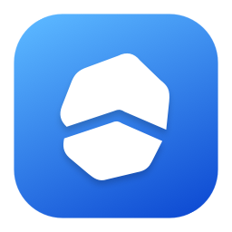
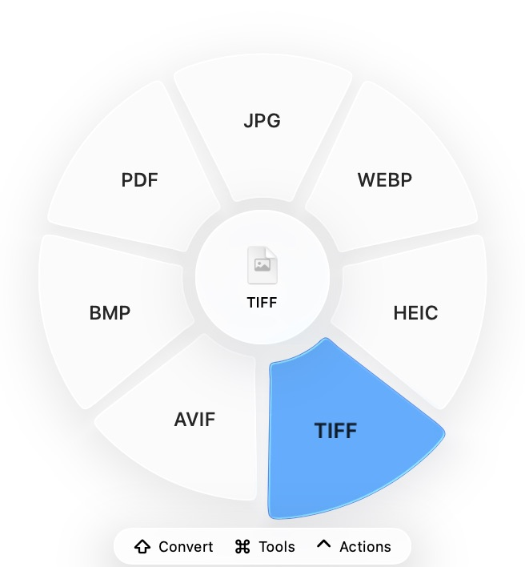

# Turnstone



A native, open source, offline file utility for macOS, inspired by [Tangerine](https://tangerineformac.com/).
Drag a file, tap a modifier, and drop onto a contextual wheel.
The implementation uses original Swift code, an original stone logo, and macOS system artwork.
The minimal interface uses native Liquid Glass on macOS 26 and later, with translucent material and standard controls on older Macs.
Controls and selection highlights follow the Mac’s system accent color, with a blue application icon.



## Run

Build with Xcode 26 or later and its macOS SDK.
The resulting app runs on macOS 13 or later.
Use full Xcode to run the XCTest suite.

```sh
./scripts/build-app.sh
open "dist/Turnstone.app"
```

The application lives in the menu bar.
Choose **Turnstone** from its menu to open the welcome window.

For the extended local format support:

```sh
brew install ffmpeg imagemagick exiftool pandoc
brew install --cask libreoffice
```

Basic image, PDF, subtitle, and archive functionality uses macOS frameworks and system utilities.
Settings shows which optional engines are available.
Missing dependencies and unsupported codecs produce an error rather than a fake result.
Writing native `.pages` files additionally requires Apple Pages and its Automation permission.

## Use

1. Start dragging one or more files in Finder.
2. Tap **Shift** for conversions, **Command** for tools, or **Control** for file actions.
3. Release the key and move onto a wheel petal.
4. Drop to apply the operation.

The center, gaps between petals, and space outside the wheel do not select an operation.
The active slice grows and lifts outward with a spring animation and an accent highlight.
Its enlarged edge remains a valid drop target, and Reduce Motion keeps the highlight still.
Choose Files from the menu or drop files into the welcome window for the keyboard workflow.
Arrow keys select a petal, Return applies it, and Escape closes the wheel.
The modifier shortcuts can be changed in Settings.

Conversions and edits save new copies beside the originals, with numbered names on collisions.
Conversions finish without opening windows or Finder.
Open **Recent Jobs** from the menu to inspect progress, errors, or completed files, and use its folder button to reveal an output.
Jobs support cancellation and per-file errors.
The explicit **Move** action relocates originals after a destination picker and collision checks.
No file is uploaded for conversion.
Pages, LibreOffice, and other independently installed applications retain their own behavior and preferences.

## Features

- A catalog of 275 directed conversion routes across 45 input formats.
- Contextual image, audio, video, PDF, document, spreadsheet, presentation, subtitle, EPUB, and archive operations.
- All 26 researched tool categories, including photo adjustment, annotation, background styling, crops, collage, metadata, compression, trimming, normalization, channels, bleeping, redaction, splitting, joining, snapshots, audio visualization, and PDF organization.
- AirDrop, a draggable floating shelf with edge pinning, clipboard file copy, Move, Copy Path, and Terminal or iTerm2.
- Native previews, editable image regions, waveform and timeline controls, page thumbnails, and batch ordering.
- Launch at login, custom modifier keys, optional selection sounds, and manual Finder reveal.

Catalog entries describe supported routes; successful conversion also depends on the input and locally available engines.

## Fidelity and limitations

The radial workflow and editor controls are independently recreated from the public site and 22 published editor screenshots.
This project does not include Tangerine's proprietary code, artwork, sounds, or payment system.

PDF-to-Office exports recover editable text and inferred table columns rather than reconstructing complex page layouts, charts, formulas, or slide objects.
Document conversions through AppKit can lose advanced Word formatting and attachments.
Pages output uses the actual native format, but that Automation integration needs verification on a Mac with Pages permission granted.
The native picker, keyboard wheel, conversion, editing, and Finder result flows have been exercised end to end.
Global Finder drag activation and dropping still need a manual gesture check because the UI automation tool cannot hold a modifier independently during its drag operation.
Legacy resource-fork-only text clippings are unsupported.
Ogg output uses Opus audio.
Compression refuses unattainable targets and keeps the original.
Image whites, blacks, clarity, and dehaze controls use Core Image approximations.
External helper processes receive termination on cancellation; descendants and helpers that ignore termination may require manual cleanup.

The app is locally ad-hoc signed by the build script.
Public distribution still requires release packaging, signing, notarization, and review of the licenses of any bundled conversion engines.
Engines are discovered locally and are not redistributed in this repository.

## Branding

The faceted stone mark is defined once in `Sources/Turnstone/BrandMark.swift` and rendered for the menu bar, interface, and app icon.
The build script generates every standard icon representation at its exact pixel size.
The stable bundle identifier preserves existing preferences and macOS permissions across the app rename.

## Develop and test

```sh
swift test
CONFIGURATION=debug ./scripts/build-app.sh
```

If the selected developer directory only contains Command Line Tools, use the full Xcode installation for tests:

```sh
DEVELOPER_DIR=/Applications/Xcode.app/Contents/Developer swift test
```

Tests generate real fixtures and check conversion outputs, source preservation, filename collisions, archive safety, process argument handling, cancellation, media duration and channels, redaction pixels, audio bleep frequencies, editable Office exports, and malformed inputs.
Optional-engine tests skip explicitly when their helper is unavailable.

`TurnstoneCore` owns format rules, validation, safe output publication, and native/media/document engines.
`Turnstone` owns the menu bar, wheel, file actions, jobs, settings, and native editors.

## License

[MIT](LICENSE) for this repository's original code.
Apple frameworks and separately installed conversion tools have their own licenses.
